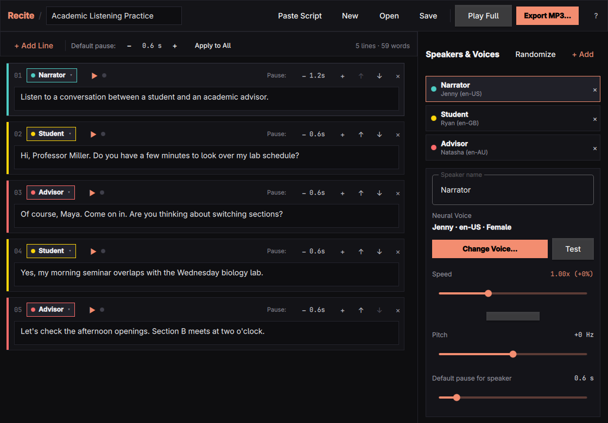

# Recite



Turn audio scripts for English listening and dialogue practice into spoken `.mp3` files using neural text-to-speech voices (`edge-tts`) — without copying lines one by one or stitching clips manually in Kdenlive.

Built using Vibe Code on Omarchy OS.

---

## Features

- **Neural Voices Across Dialects**: Browse, filter, favorite, and audition English and multilingual neural voices (`Jenny`, `Guy`, `Aria`, `Davis`, `Sonia`, `Ryan`, etc.) across 14+ English locales and accents.
- **Lectures & Multi-Speaker Dialogues**: Paste raw scripts (`Narrator:`, `Student:`, `Advisor:`, `[pause 1.5s]`) or write line-by-line with automatic speaker voice assignment and one-click dialect randomization across English accents.
- **Voice, Speed, Pitch & Pauses**: Adjust rate (`-50%` to `+100%`), pitch (`-50Hz` to `+50Hz`), and pause duration per speaker or per line.
- **Instant Caching & Preview**: Preview individual lines or the full stitched script with live line highlighting.
- **Export for Direct Use or Kdenlive**: Export a single combined `.mp3` with exact pauses (plus optional `-14 LUFS` loudness normalization) and/or numbered per-line `.mp3` clips (`001_Narrator.mp3`, `002_Student.mp3`, …).
- **Save & Reopen Projects**: Save script projects as `.recite` files or import `.txt` scripts.

---

## Prerequisites

Before installing and running this application, ensure your system meets the following requirements:

- **Operating System:** Omarchy OS (or compatible Arch-based Linux distribution)
- **Runtime Dependencies:** `qt6-base`, `qt6-declarative`, `qt6-multimedia`, `qt6-wayland`, `ffmpeg`, `python`, `xdg-desktop-portal` (plus the `edge-tts` Python package, which can also be installed from within the app)
- **Build Dependencies:** `gcc`, `make`, `qmake6` (included in `qt6-base`)
- **Git**

---

## Installation

1. Clone the repository:

```bash
git clone https://github.com/bnleez1/recite.git
cd recite
```

2. Build and run tests:

```bash
./bin/build
./bin/test
```

3. Install the Arch package (`pkgbuild/PKGBUILD`):

```bash
./bin/install
```

---

## Usage

Launch the desktop application from your app launcher or terminal (`recite`), or run the built binary directly (`./build/recite`).

See the full **[User Manual](docs/USER_MANUAL.md)** for a step-by-step guide to script formatting, speaker/voice controls, line overrides, MP3 exporting, and troubleshooting.

### Keyboard Shortcuts

| Shortcut | Action |
| --- | --- |
| `Space` / `Ctrl+Space` | Play or stop full script preview |
| `Ctrl+Enter` | Play selected line |
| `Ctrl+I` | Paste or import a script |
| `Ctrl+L` | Add a new line after selection |
| `Ctrl+N` | New project |
| `Ctrl+O` | Open `.recite` project or `.txt` script |
| `Ctrl+S` / `Ctrl+Shift+S` | Save / Save As |
| `Ctrl+E` | Export combined `.mp3` or individual clips |
| `Ctrl+Z` / `Ctrl+Shift+Z` | Undo / Redo |
| `?` / `F1` | Show keyboard shortcuts |
| `Q` / `Ctrl+Q` | Quit |

### CLI & Agent Usage

```sh
recite check [script.recite] --json
recite voices --locale en-US --json
recite export lesson.recite --output lesson.mp3 --clips-dir ./clips --json
recite skill install
```

---

## Feedback & Suggestions

Comments, real-world use cases, and improvement ideas are welcome! Feel free to open an issue on [GitHub Issues](https://github.com/bnleez1/recite/issues) to:

- Share how you are using Recite (for example, classroom listening activities, podcasts, or content creation)
- Suggest new features, workflow improvements, or UI refinements
- Report bugs or unexpected behavior

---

## Contributing

Contributions are welcome! To keep the project aligned with its core goals, direct push access to the `main` branch is restricted. Please follow the pull request workflow:

1. Fork the repository.
2. Create a new feature branch (`git checkout -b feature/your-feature-name`).
3. Commit your changes (`git commit -m "Add description of your changes"`).
4. Push to your branch (`git push origin feature/your-feature-name`).
5. Open a Pull Request for review and testing.

---

## License & Third-Party Notices

This project is licensed under the MIT License. See the [LICENSE](LICENSE) file for details.

- **Adapted Patterns:** Theming, translation, and portal file-picker patterns are adapted from Omacut and Monologue (Copyright © David Heinemeier Hansson, MIT License).
- **External Dependencies:** Recite invokes system-installed [Qt 6](https://www.qt.io/), [FFmpeg](https://ffmpeg.org/), and the third-party [`edge-tts`](https://github.com/rany2/edge-tts) Python package as external tools rather than bundling them.
- **Disclaimer:** Recite is an independent open-source project and is not affiliated with, endorsed by, or sponsored by Microsoft. Voice synthesis relies on Microsoft's online Edge Read Aloud service via `edge-tts`; users are responsible for complying with applicable service terms and copyright laws for any scripts they input or audio they distribute.
